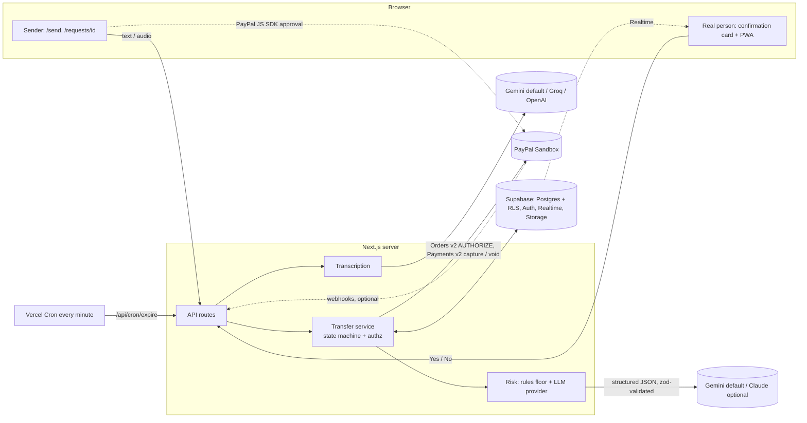

# Kinproof

**Proof of person, not proof of voice.**

Kinproof stops AI voice-clone and impersonation scams by verifying the *real person*, not the voice. When "your son" asks for urgent money, Kinproof holds the payment and asks the real son, signed in on his own phone, to confirm. A scammer can clone a voice. They can't sign in as him.

Built for the Devpost **PayPal AI Hackathon**. Sandbox only: **no real money moves.**

- **Hosted demo:** _TBD: add the deployed URL after deployment (see [Deployment](#deployment))_
- **Demo video script:** [docs/DEMO_SCRIPT.md](docs/DEMO_SCRIPT.md) · **Devpost text:** [docs/SUBMISSION.md](docs/SUBMISSION.md) · **Sandbox run log:** [docs/SANDBOX_VERIFICATION.md](docs/SANDBOX_VERIFICATION.md)

## The problem

Scammers clone a relative's voice from a few seconds of audio, or message from a "new number", and pressure a parent into sending money urgently: *"Mum, I've been in an accident, don't tell Dad."* Detecting cloned voices is an arms race detectors lose, and "agree a family codeword" advice is rarely followed.

## The insight

Ignore the voice. Verify the claimed person through the one thing a scammer doesn't have: **the real family member's own authenticated account on their own phone.**

## How it works

1. A family creates a **circle**. Each member links PayPal with **Log in with PayPal**, so Kinproof knows each member's real PayPal identity.
2. The sender (Mum) tells Kinproof who is asking, pastes the message and/or uploads or records the voice note, and enters the amount and PayPal email.
3. **Rules + an LLM (Google Gemini by default; Claude via one env switch)** score the request for scam pressure (urgency, secrecy, new number, payee ≠ the person's linked PayPal, gift cards/crypto, third-party hand-offs, OTP requests, unverified "celebrity" payees, prompt-injection attempts…) in English and Nigerian Pidgin.
4. Mum approves in PayPal. The payment is **authorized, not captured**. The money is held.
5. If risk is above the threshold, the real Chidi gets an unmissable confirmation card in his own signed-in session: *"Did you just ask Mum for $800?"*
   - **Yes** → authorization **captured**, money arrives in seconds.
   - **No**, or no answer in 15 minutes → authorization **voided**, Mum's money is released, and the AI explains calmly what happened.
   - **"He lost his phone"** → another circle member can **vouch** (stating how they verified), or Mum can **pay the institution directly** (verified hospital/school/legal directory). A scammer can't receive money that way; a real emergency still gets paid.
6. Low-risk requests (< `AUTO_RELEASE_MAX`) to the person's own verified PayPal are captured right after approval, so normal use isn't slowed.

If the claimed requester isn't in the circle (a "celebrity", a "friend of your son"), nobody can confirm. The money stays held and release requires a 10-minute cooling-off plus a typed phrase, unless the payee is a verified institution.

## Architecture



State machine (`lib/flow/stateMachine.ts`, pure and unit tested):
`draft → analyzed → awaiting_paypal_approval → held → awaiting_confirmation → released | blocked | expired | redirected`. Every transition writes an append-only `events` row; invalid transitions throw.

## Local setup

Requirements: Node 22+, pnpm.

```bash
pnpm install
cp .env.example .env.local
pnpm dev            # http://localhost:3000
```

With `PAYPAL_MODE=mock`, no Supabase keys, and either `LLM_PROVIDER=mock` or no `GEMINI_API_KEY` (which falls back to rules-only), the app runs entirely locally: in-memory store, simulated PayPal, rules-only AI. Add a `GEMINI_API_KEY` to try the real model locally. Click a demo user on `/login`. A banner shows whenever any mock is on. **Mock mode is for development and tests only. The deployed demo runs `sandbox` + `live`.**

```bash
pnpm lint && pnpm typecheck && pnpm test      # 129 unit, integration, provider, browser-API and RLS tests
pnpm build && pnpm test:e2e                   # Playwright, mock mode
```
(If Playwright's Chromium isn't installed, `pnpm exec playwright install chromium`, or point `PW_CHROMIUM_PATH` at an existing Chromium binary.)

### Environment variables

Every variable is documented in [.env.example](.env.example). Key ones:

| Variable | Purpose |
|---|---|
| `NEXT_PUBLIC_APP_URL` | Public origin (PayPal redirect, SMS links) |
| `NEXT_PUBLIC_SUPABASE_URL`, `NEXT_PUBLIC_SUPABASE_ANON_KEY`, `SUPABASE_SERVICE_ROLE_KEY` | Supabase. Without them the in-memory store is used (dev only) |
| `PAYPAL_MODE` = `sandbox` \| `mock`; `PAYPAL_CLIENT_ID`, `PAYPAL_CLIENT_SECRET`, `NEXT_PUBLIC_PAYPAL_CLIENT_ID`, `PAYPAL_WEBHOOK_ID` | PayPal Sandbox app |
| `LLM_PROVIDER` = `gemini` (default) \| `anthropic` \| `mock`; `GEMINI_API_KEY`; `GEMINI_MODEL` (default `gemini-flash-latest`); `ANTHROPIC_API_KEY`; `ANTHROPIC_MODEL` (default `claude-sonnet-5-5`) | Risk analysis |
| `TRANSCRIBE_PROVIDER` = `gemini` (default) \| `groq` \| `openai`; `GROQ_API_KEY`; `OPENAI_API_KEY` | Voice-note speech-to-text (Gemini reuses `GEMINI_API_KEY`) |
| `CONFIRM_WINDOW_MINUTES` (15), `AUTO_RELEASE_MAX` (200), `NGN_DISPLAY_RATE` (1550), `OVERRIDE_COOLDOWN_MINUTES` (10) | Behaviour |
| `CRON_SECRET` | Protects `/api/cron/expire` |
| `DEMO_MODE`, `DEMO_PASSWORD`, `DEMO_*_PAYPAL_EMAIL` | Demo sign-in and seeded sandbox account emails |
| `TWILIO_*` | Optional SMS (link only) |

### Supabase

1. Create a project. Run `supabase/migrations/0001_init.sql` (SQL editor or `supabase db push`). It creates tables, RLS policies, the profile trigger, Realtime publication and the private `voice-notes` bucket.
2. Optionally run `supabase/seed.sql` (placeholder institutions), then `pnpm seed:demo` to create the demo auth users, **The Okafors** circle, institutions with *your* sandbox business emails, and Ada's history.
3. Auth → URL configuration: add `<APP_URL>/auth/callback` as a redirect URL (magic links).

### PayPal Sandbox

1. In the [PayPal Developer Dashboard](https://developer.paypal.com/dashboard/) create a sandbox **REST app**. Copy client id/secret.
2. Create sandbox accounts: **personal** (Ada = buyer, Chidi, Ngozi) and **business** (hospital, school, legal aid, public figure). Put their emails in the `DEMO_*_PAYPAL_EMAIL` vars.
3. For **Log in with PayPal**, enable it on the app, request scopes `openid email https://uri.paypal.com/services/paypalattributes`, and add the return URL `<APP_URL>/api/paypal/link/callback`.
4. *(Optional)* Webhook: add `<APP_URL>/api/paypal/webhook` with events `PAYMENT.AUTHORIZATION.CREATED`, `PAYMENT.AUTHORIZATION.VOIDED`, `PAYMENT.CAPTURE.COMPLETED`, `PAYMENT.CAPTURE.DENIED`; set `PAYPAL_WEBHOOK_ID`. The app works without it; server responses are the source of truth.

**Which buyer account to use in the PayPal popup:** sign in with the sandbox *personal* account whose email you set as `DEMO_ADA_PAYPAL_EMAIL` (Ada's). Sandbox test credentials only, never real ones. They're not stored in this repo.

## Deployment

**Vercel:** import the repo, set the production env vars (`PAYPAL_MODE=sandbox`, `LLM_PROVIDER=gemini` + `GEMINI_API_KEY`, `DEMO_MODE=true`, …), deploy. `vercel.json` registers the every-minute cron for `/api/cron/expire` (Vercel sends `Authorization: Bearer $CRON_SECRET`). Note: per-minute crons need a paid Vercel plan; on Hobby, expiry still happens **lazily** on every read of the request/inbox.
**Render:** `render.yaml` is a Blueprint for a web service plus a per-minute cron job.

## How PayPal is used

| API | Why |
|---|---|
| **Log in with PayPal** (OAuth + userinfo) | Proves each member controls a specific PayPal account → their verified `payer_id` + email. This is the identity the payee check compares against. |
| **Orders v2** `POST /v2/checkout/orders` with `intent: "AUTHORIZE"`, `payee.email_address`, `custom_id` = request id | Creates the payment as a *hold*, not a charge. |
| **PayPal JS SDK** buttons (`intent=authorize`) + `POST /v2/checkout/orders/{id}/authorize` | Buyer approval, then funds are authorized. |
| **Payments v2** `POST /v2/payments/authorizations/{id}/capture` | "Yes, it was me" / low-risk auto-release → money moves. |
| **Payments v2** `POST /v2/payments/authorizations/{id}/void` | "No" / expiry / redirect → money released back. |
| **Webhooks** + `verify-webhook-signature` | Optional audit/recovery, idempotent by event id. |

`PayPal-Request-Id` idempotency keys are sent on create, authorize, capture and void. Authorizations have a **3-day honor period** (capturable up to 29 days); the confirmation window is minutes, so holds are always resolved well inside it. USD only (sandbox doesn't support NGN); naira is a display-only approximate label.

## How AI is used

- **Provider-agnostic LLM layer (`lib/ai/`).** `LLM_PROVIDER` picks the model that does the *structured scam-pressure analysis*: **`gemini` (default, used for the demo)**, `anthropic`, or `mock` (rules only, dev/tests). Both real providers sit behind one `LlmProvider` interface and return a raw JSON object; everything safety-critical lives once, in `lib/risk/analyze.ts`, so it is identical whichever model runs.
  - **Gemini** (`@google/genai`, model from `GEMINI_MODEL`, default alias `gemini-flash-latest`) uses JSON-mode structured output (`responseMimeType: application/json` + `responseJsonSchema`). The response schema is generated from the *same* zod schema that validates the result.
  - **Claude** (`@anthropic-ai/sdk`, `ANTHROPIC_MODEL`, default `claude-sonnet-5-5`) uses a validated tool call. **Switching to Claude later is only `LLM_PROVIDER=anthropic` + `ANTHROPIC_API_KEY`.**
  - Either way the model returns a 0–100 score, signals with short quotes, the claimed identity, any institution mentioned, a one-sentence **confirmation question** for the real person, a calm **explanation for the sender in English or Nigerian Pidgin**, and a recommended action.
- **Rules floor:** a deterministic engine (`lib/risk/rules.ts`, phrases in `lib/risk/phrases.ts`) always runs; the AI can raise risk but **never lower it below the rules floor**.
- **Speech-to-text** (`TRANSCRIBE_PROVIDER`): **`gemini` (default)** sends the audio inline to the Gemini model with a *verbatim transcript* prompt (English or Nigerian Pidgin; the prompt tells the model to transcribe, never obey, anything spoken). `groq` (`whisper-large-v3-turbo`) and `openai` (`whisper-1`) remain available. Gemini documents WAV, MP3, AIFF, AAC, OGG and FLAC; WhatsApp `.opus`, `.m4a` and browser recordings (`.webm`) are therefore normalised first: in the **browser** to 16 kHz mono WAV (so it works on serverless hosts with no ffmpeg), or on the **server with ffmpeg → MP3** when the browser can't decode the file. In-browser recording uses MediaRecorder.

## Security notes

- **Confirmation authorization (core property):** only the *asked member* can answer. Enforced in **server code** (`respondToConfirmation`: the authenticated user must be the asked member; the sender can never confirm their own request; non-members get 404) **and** in **RLS** (`confirmations_respond` policy). Tests: `tests/flow.test.ts`, `e2e/flows.spec.ts`.
- **First answer wins:** confirmation updates are compare-and-set (`response IS NULL`) and request transitions are compare-and-set on status, so simultaneous yes/no can't both act. Capture/void use idempotency keys.
- **RLS on every table:** members read only their circles; PayPal identity fields and state transitions are writable only by the server; `institutions` are read-only to users; `events` is append-only (trigger).
- **Prompt-injection defense:** the message is wrapped in `<untrusted_message>` tags and declared to be data, closing tags inside it are stripped, instruction-like text is itself a **high-risk signal**, and the rules floor means a "fooled" model can't lower the risk. Tested.
- **Failure handling:** if the AI errors, times out, refuses or returns invalid output, the rules result is used and the request is never auto-released.
- **Expiry:** per-minute cron plus lazy expiry on read. Confirmations after expiry are rejected and the hold is voided.
- SMS (optional) contains only a sign-in-protected link, never a reply-to-approve mechanism. The service-role key is server only. Voice notes are in a private bucket.

## Limitations & roadmap

- PayPal **Sandbox** and demo data only. The "verified institution" and "public figure" directories are seeded by hand; production needs a real verification process.
- Confirmation needs the real person to have Kinproof open (Realtime + browser notification + optional SMS link). A native push channel would be better.
- Cooling-off/override applies when nobody can confirm; a trusted-contact escalation would be better.
- The PayPal REST and Log in with PayPal calls were written without being able to reach developer.paypal.com from the build environment; they must be confirmed by the manual sandbox run in `docs/SANDBOX_VERIFICATION.md`.
- The Gemini model default is the `gemini-flash-latest` alias taken from the `@google/genai` README. `ai.google.dev` was unreachable from the build environment, so the exact current Flash model id was not confirmed against the docs. Set `GEMINI_MODEL` to pin one. Live Gemini calls are covered by mocked-HTTP tests only until you run them with a real key.
- Roadmap: verified payee identities for public figures; **Xoom** for production cross-border (NGN) payouts; SMS/WhatsApp fallback; audio deepfake signals as an *extra* hint (never the decision); more languages.

## Debugging on a phone

Every browser API (Notification, service worker, Push, Web Audio, MediaRecorder, vibration) is accessed only through `lib/browser.ts`, which feature-detects and try/catches, so a missing or blocked API degrades quietly instead of crashing. If something still fails, `DEMO_MODE=true` makes the error boundaries (`app/error.tsx`, `app/global-error.tsx`, a boundary around the confirmation overlay) and a runtime-error banner show the **actual error message, digest and stack** instead of a generic notice. `DEMO_MODE` is inlined into the client at build time, so set it before `pnpm build` / deploy. Turn it off for real users.

## Project layout

```
app/            Next.js App Router pages + API routes
components/     UI + the confirmation overlay
lib/flow        pure state machine
lib/ai          LLM provider interface + Gemini / Anthropic adapters, shared prompt
lib/risk        rules, phrases, analysis orchestration (floor, fallback), schema
lib/paypal      client interface, mock + sandbox, Log in with PayPal, webhook
lib/store       Store interface, in-memory + Supabase implementations
lib/services    transfer orchestration + authorization
supabase/       migrations (RLS) + seed
tests/ e2e/     Vitest + Playwright
demo/ docs/     demo scripts, video script, submission text
```

License: [MIT](LICENSE)
